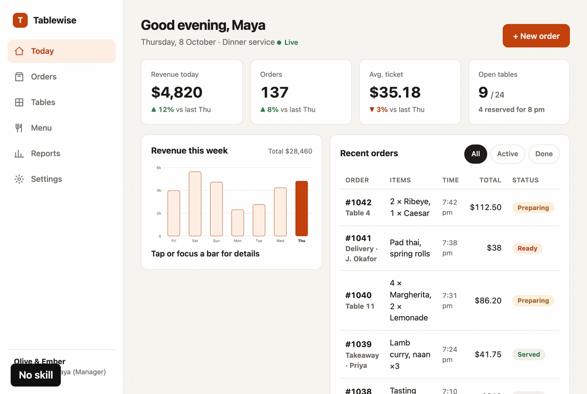
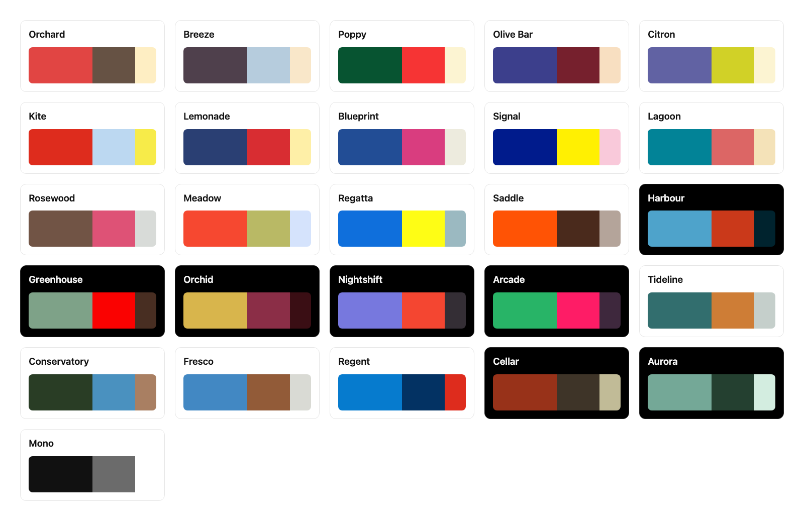
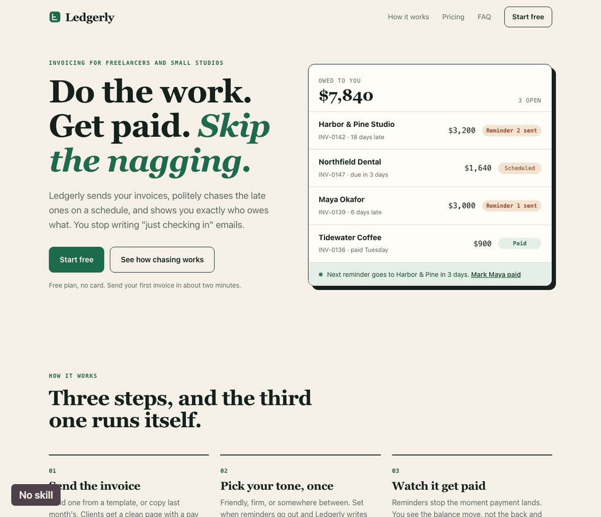
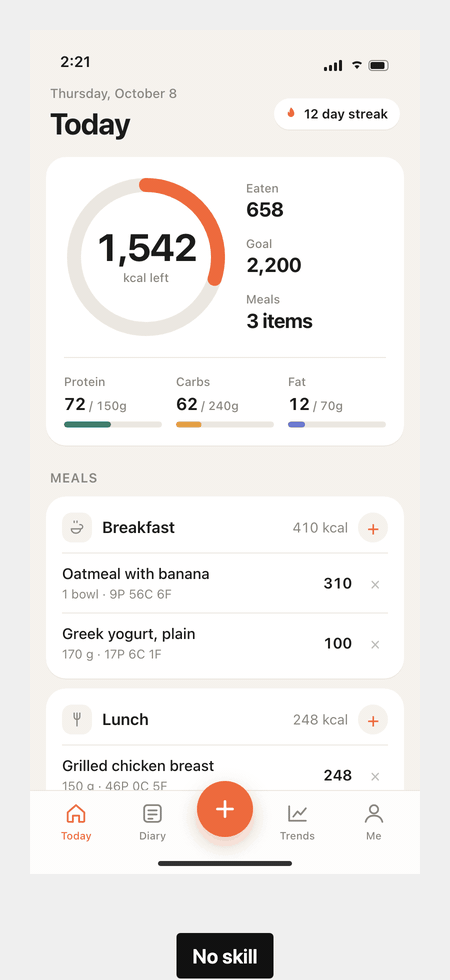
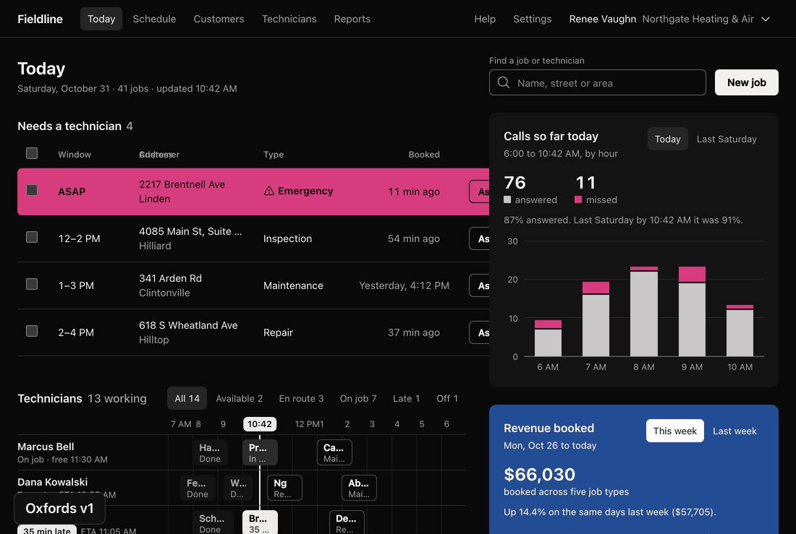
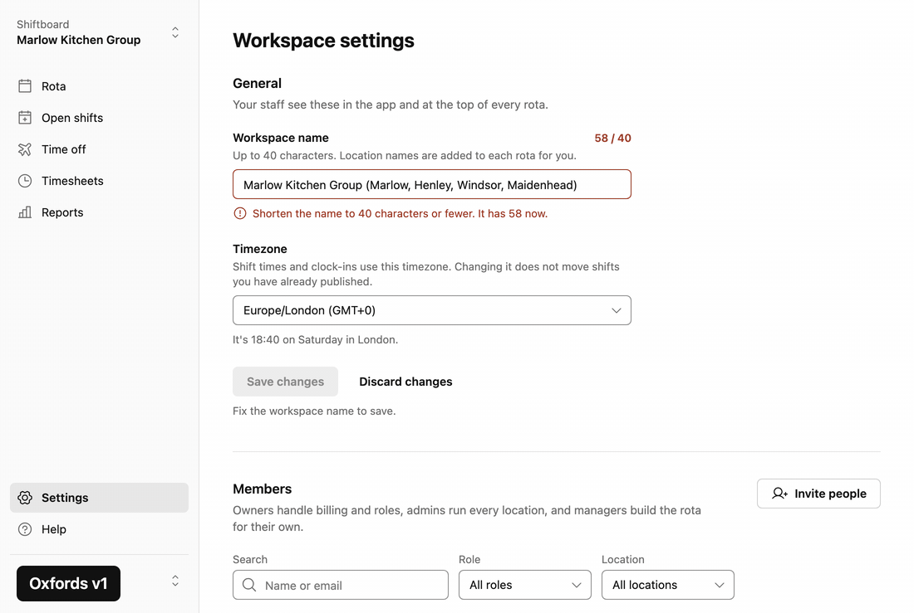

<p align="center">
  
</p>

<p align="center">
  <b>Your AI builds UIs that look like someone actually finished them.</b><br>
  A UI/UX skill for Claude Code, Codex and Cursor. Polished, plain, no AI slop.
</p>

<p align="center">
  <a href="LICENSE"></a>
  
  
</p>

---

Oxfords, not brogues. An Oxford is the plain shoe, and a brogue is the same shoe with a bunch of
decoration punched into it.

So this skill won't make your site look insane, and it won't give you crazy animations. There
are good skills for that already. What I wanted was the boring part done properly: a screen
that's clear, that's finished, and that doesn't have the stuff on it that tells everyone an AI
made it.

<p align="center">
  
</p>

<p align="center">
  
</p>

<p align="center"><sub>A dashboard built with no skill, then redesigned with Oxfords. Same data, same labels, same links.</sub></p>

## What you get

**The half that gets skipped.** AI builds the happy path and then stops. Oxfords makes it keep
going, so you get the button states, the feedback when you click something, the empty screen,
the error screen, what happens with a really long name or 10,000 rows, keyboard focus, and
tap targets that work on a phone.

**A screen you can actually scan.** Nobody reads a UI. You land on it with one question and
you hunt for the answer. So Oxfords lines things up on edges, lets the data decide what
component to use, and makes one thing on the screen important instead of all of it.

**No AI slop.** I kept seeing the same tells in everything AI builds, even with good design
skills loaded, so there's a strict list of them and what to use instead:

| Out | In |
|---|---|
| A coloured bar down the side of the active nav item | A full-row fill |
| A card around everything, cards inside cards | Space, alignment, one hairline |
| A small uppercase label above every heading | The heading |
| Inter, Geist, Poppins, Instrument Serif, Playfair | The system font, or a face you can give a reason for |
| Emoji as icons, the stock icon set at default stroke | One icon set, one weight, matched to the text |
| Bone and orange, white and blue, purple gradients | A palette chosen for the product, with a reason |
| Gradient text, glows | One accent, used for action and state |
| A tinted pill on every status | Colour only where something needs attention |
| Bounce, fade-up on everything, pulsing dots | Short ease-out transitions that explain a change |
| "Seamless", "Get started", Acme, 99.9% | The plain sentence and believable data |

**Colours somebody actually picked.** You've probably noticed Claude goes for the same bone
background with an orange accent on pretty much everything now. Before that it was purple
gradients, and if you tell it to be "clean" you get white, grey and one blue button. They're
all the same problem, the colour got picked by default. So Oxfords comes with 26 palettes,
three colours each, and the agent has to choose one for your product and say why. The
palette goes on top of proper neutrals though, white, black and greys still do most of the
work, so you don't end up with a page that's cream from edge to edge.

And the agent doesn't type colours by hand anymore. A script turns the palette into every
colour the page needs: the hover and pressed shades, a version of each colour that's actually
readable as text, three levels of grey for text, red for delete that never gets mixed up with
your brand, and a dark mode that's designed instead of just flipped. Every pair is contrast
checked before it's written. Got a client colour? Give it that and it builds the rest around it.

```bash
node skills/oxfords/scripts/palette.mjs Tideline --mode both
node skills/oxfords/scripts/palette.mjs --brand "#FF8A3D"
```

<p align="center">
  
</p>

**Checkers, so it's not just vibes.** The first one reads your code, no dependencies:

```bash
node skills/oxfords/scripts/check.mjs ./src
```

```text
src/components/Sidebar.tsx
  FAIL  accent-rail          coloured bar on the side of an element; use a full fill or nothing  (line 42)
        border-left: 3px solid
  FAIL  default-font         default font nobody chose; use the system stack or a face with a stated reason  (line 7)
  WARN  viewport-100vh       100vh jumps on phones; use dvh or svh  (line 18)

1 file, 2 fail, 1 warn
```

It exits with an error when something fails, so you can put it in CI or a pre-commit hook.

The second one actually opens the page. It renders it on a phone width and a desktop width,
in light and dark, saves the screenshots, and measures the stuff you can't see in code: text
that fails contrast, text that's clipped or overlapping, sideways scrolling, focus you can't
see, buttons too small to tap, and how much of the screen is colour. It needs Playwright, and
if you don't have it, it tells you and gets out of the way.

```bash
node skills/oxfords/scripts/shoot.mjs ./dist/index.html
```

## Install

**Claude Code, Codex and other agents that read skills**

```bash
npx skills add arhamhi/oxfords
```

Or copy `skills/oxfords` into your skills folder (`~/.claude/skills/` for Claude Code,
`~/.agents/skills/` for Codex and others).

**Cursor**

Copy `skills/oxfords` into your project and `adapters/cursor/oxfords.mdc` into
`.cursor/rules/`.

**Anything that reads AGENTS.md**

Copy `skills/oxfords` into your project and paste `adapters/AGENTS.md` into your `AGENTS.md`.

## Use

You don't have to do anything special. Ask for UI work the way you already do and the skill
loads when the task is a UI.

```text
Build the orders dashboard.
Review this settings page with oxfords.
This looks AI-generated. Fix it.
```

It works in three modes:

| Mode | What happens |
|---|---|
| Build | Reads the brief, works a twelve-step build order from intent to finished states, measures the result and fills a done gate |
| Redesign | Writes down what has to stay first (links, labels, fields, data), then redesigns, then proves nothing went missing |
| Review | Looks at the screenshots first, measures second, reports each finding as symptom, fix and reason |
| Fix | Changes only what a finding names and leaves your copy and identity alone |

## What is inside

```text
skills/oxfords/
  SKILL.md                       build order, done gate, slop floor, numbers
  references/
    app-ui.md                    dashboards, tables, charts, settings
    mobile.md                    app screens, navigation, sheets, gestures
    landing.md                   message, structure, what to leave out
    redesign.md                  what to keep, what to change, in what order
    states-forms-copy.md         every state, forms, errors, copy, accessibility
    colour.md                    neutrals, palettes, states, dark mode, client colours
    slop-floor.md                the full ban list with replacements
    motion.md                    timing, easing, gestures, reduced motion
    review.md                    fresh eyes, the two passes, severity, when to stop
  scripts/
    palette.mjs                  turns a palette into every colour token, contrast checked
    palettes.json                the 26 palettes
    check.mjs                    the slop checker, reads code
    shoot.mjs                    the render check, opens the page and measures it
    keep.mjs                     checks a redesign kept every link, label and field
```

The main file is short on purpose. Your agent reads it every time, and only opens a reference
file for the thing it's actually building.

## What Oxfords is not

- **It won't replace your brand.** If your project already has colours or a design system,
  those win. The palettes are for when you've got nothing.
- **It won't give you a look.** If you want a landing page with a signature animation, use a
  design skill built for that and let Oxfords check the result after.
- **It can't see everything.** The render check measures contrast, clipping and focus, but it
  can't tell you've put a card inside a card or a button that does nothing. Those are on a
  short list you check by eye.

One thing I had to be careful with: plain doesn't mean empty. If you strip all the slop out
and add nothing, you get a grey page with one accent colour, and that's just a different kind
of generic. So Oxfords asks for real content, one clear thing to look at first, and choices
you can give a reason for.

## More examples

These two are from the first version of Oxfords. Same brief twice, first with no skill and then
with Oxfords.

**A startup landing page**

<p align="center">
  
</p>

The one without the skill looks fine at first, I'll be honest. But it's the bone background
again, with a little uppercase label over every section, numbered steps and an italic word in
the headline. You've seen that page a hundred times. The Oxfords one sits on white, shows the
actual product, and keeps the colour for one section, one button and the number you owe.

**A calorie tracking app**

<p align="center">
  
</p>

Pure black, so it looks right on an OLED screen. The add button comes out of the middle of
the tab bar, the tab bar is glass with the list scrolling under it, and only the things that
matter get colour.

## How it was tested

I froze a copy of the last version of Oxfords and a copy of this one, wrote four briefs that
each push on something different, and had the same model build every brief twice, once with
each. The briefs are a dark dispatch board for an HVAC company, a landing page that has to use
a client's orange, a settings screen in light and dark, and a redesign of an existing screen
that has to keep its labels and links.

Then a fresh judge on a different model got the brief and the screenshots and nothing else.
The two builds were labelled X and Y in a random order, it scored seven things out of 5 and
picked one. I only unblinded once all four had answered.

```text
                      judge picked   points, old / new   checker warnings, old / new
dispatch board        new            19 / 28             6 / 0
landing page          old            29 / 23             0 / 0
workspace settings    new            27 / 29             42 / 0
redesign              new            24 / 29             1 / 0
```

The new one won three out of four, and every judge that picked it gave colour as a reason:
states that mean something, the client's brand kept as the brand, delete in red. The landing
page went to the old one and the judge was right. The new build put a muddy brown card where
the price lives and built the hero like an app with tabs and a chart, when the old one just
showed the report the clinic actually gets. The brown was a bug in the colour engine and
that's fixed. Everything else the judges flagged, on either side, is a rule in the skill now.

That's 22 rule changes I haven't re-run yet, so treat this as one round. One judge per brief,
one judge model, four briefs, and 29 to 27 on settings is close to a coin flip. One judge also
said a link failed contrast when it measures 5.18:1, so the judges get things wrong too.

<p align="center">
  
</p>

<p align="center">
  
</p>

Every brief and both builds are in [`docs/test-run`](docs/test-run), so you can run the
checkers on them yourself:

```bash
node skills/oxfords/scripts/check.mjs docs/test-run/settings/old.html
node skills/oxfords/scripts/shoot.mjs docs/test-run/settings/old.html
```

The six builds in [`docs/builds`](docs/builds) are older, Oxfords against no skill at all, and
that one isn't a fair fight. I'm not going to pretend it is. The no-skill builds are first
attempts from Claude Sonnet and the Oxfords ones went through a few rounds while I was fixing
the skill. Take them as what the skill is going for. And the checkers only catch the
mechanical stuff. Most of what's different in those GIFs is the part they can't see.

<p align="center">
  
</p>

## Credits

I didn't come up with most of this. The usability side I learned from
[Kole Jain](https://www.youtube.com/@KoleJain)'s videos, and you should watch them. I also
studied [impeccable](https://github.com/pbakaus/impeccable) by Paul Bakaus,
[taste-skill](https://github.com/Leonxlnx/taste-skill) by Leonxlnx, and
[apple-design](https://github.com/emilkowalski/skills) by Emil Kowalski, and took ideas from
each. Everything here is written in my own words, and what came from where is in
[CREDITS.md](CREDITS.md).

The paintings in this repo were made in code, stroke by stroke. They're all in [`art`](art).

## Licence

MIT. See [LICENSE](LICENSE).
